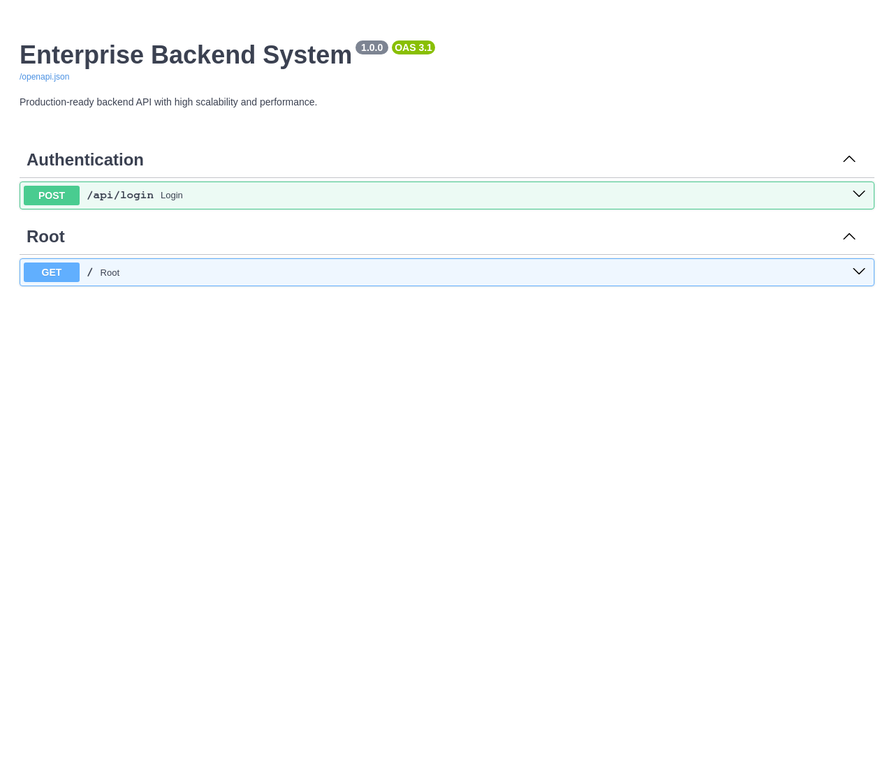
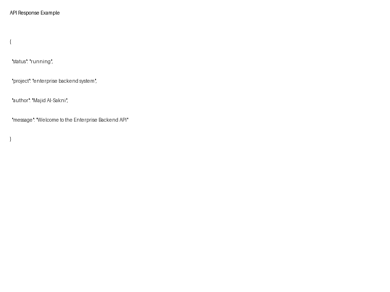

# Enterprise Backend System

Production-ready backend API built with FastAPI, designed for high scalability and performance.

---

## API Documentation



This is the interactive Swagger UI documentation, automatically generated by FastAPI, providing a clear overview of all available endpoints and their functionalities. It's a crucial tool for developers to understand and interact with the API.

---

## API Response Example



An example of a successful JSON response from the root endpoint, demonstrating the API's operational status and basic information.

---

## Features

-   **JWT Authentication ready:** Secure user authentication and authorization.
-   **REST API structure:** Follows industry best practices for API design.
-   **Production-ready architecture:** Built for deployment in real-world environments.
-   **Database ready:** Designed for seamless integration with various databases.
-   **Scalable design:** Capable of handling increasing loads and data volumes.
-   **Clean code structure:** Emphasizes readability, maintainability, and modularity.
-   **High Performance:** Leverages FastAPI's asynchronous capabilities for speed.

---

## Project Structure

```bash
enterprise-backend-system
│
├── app
│   ├── main.py
│
├── models
│   └── user.py
│
├── database
│   └── db.py
│
├── api
│   └── auth.py
│
├── screenshots
│   ├── api_docs_swagger.webp
│   └── api_response_example.png
├── requirements.txt
└── README.md
```

---

## Getting Started

### Installation

```bash
pip install -r requirements.txt
```

### Running the Project

```bash
uvicorn app.main:app --reload
```

Access the API at `http://127.0.0.1:8000` and the interactive documentation at `http://127.0.0.1:8000/docs`.

---

## Technologies Used

<p align="center">
  
</p>

---

## Contact

For any inquiries or collaborations, feel free to reach out:

-   **Email:** majidalsakani@gmail.com
-   **GitHub:** [https://github.com/majid-alsakani](https://github.com/majid-alsakani)
